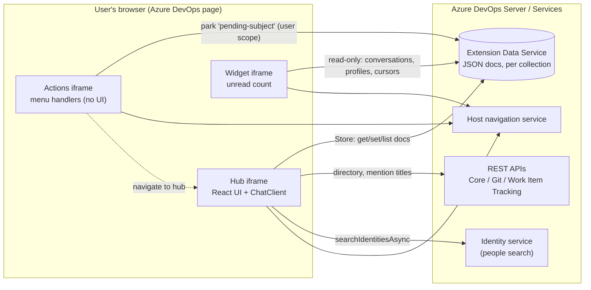
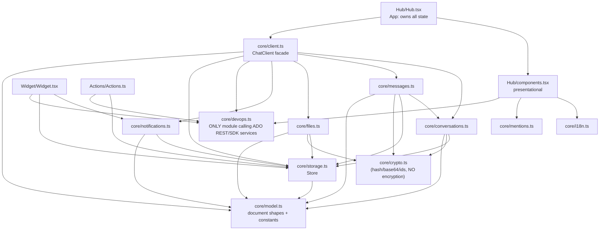
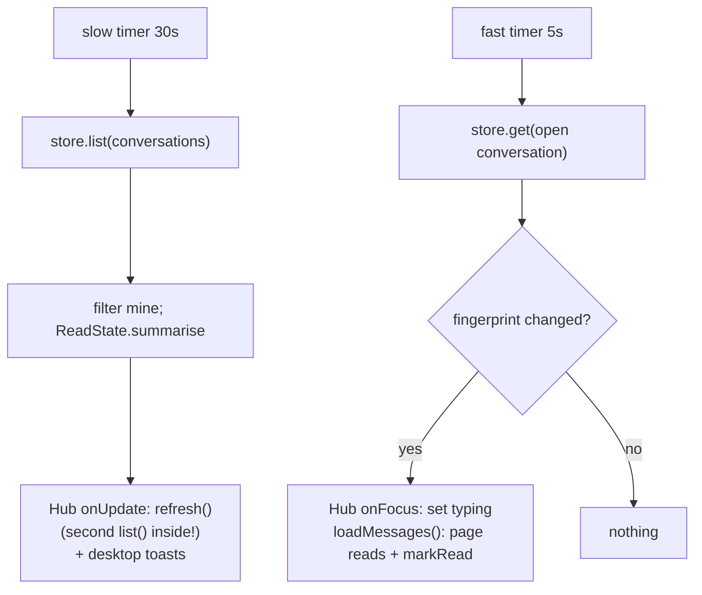
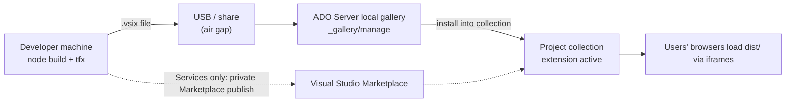

# 03 - Architecture

All claims CONFIRMED from source unless labelled. Line numbers are hints from the graph (see `source-index.json`); grep the symbol if they drifted.

## The one constraint that shapes everything

Azure DevOps gives an extension **no server of its own and no blob store**. The only persistence is the *Extension Data Service*: a JSON document store scoped to (publisher, extension, project collection), with a 50-character document id limit, optimistic concurrency via `__etag`, "get all documents" capped at 100,000, and an **undocumented document size limit**. Everything in this design (paged messages, 64 KiB attachment chunks) exists because of that.

## Three iframes, three bundles

Azure DevOps loads each contribution in its own sandboxed iframe, so there are three independent webpack bundles (`webpack.config.js`):

| Bundle | Entry | HTML | Contribution (id in manifest) |
| --- | --- | --- | --- |
| `hub` | `src/Hub/Hub.tsx` | `dist/hub/Hub.html` | `chat-hub` (hub "Messages" under hub group "Chat") |
| `widget` | `src/Widget/Widget.tsx` | `dist/widget/Widget.html` | `chat-unread-widget` (dashboard widget) |
| `actions` | `src/Actions/Actions.ts` | `dist/actions/Actions.html` | `discuss-work-item`, `discuss-commit` (menu actions, hidden frame, no UI) |

All three import from `src/core/` via the alias `@core/*`. Bundles carry a content hash in their filename (`hub/hub.1a2b3c4d.js`) so the CDN cannot serve a stale build.

## Overall architecture



## Module dependency graph (src/core and UI)

Graphify found **no import cycles** (`graphify-out/GRAPH_REPORT.md`). Arrows mean "imports / uses".



Rules this graph encodes (do not break them):
1. **UI never touches `Store` directly** (except `Hub.tsx` reading two user settings and `Widget.tsx`/`Actions.ts`, which have no ChatClient). Everything else goes through `ChatClient`.
2. **`devops.ts` is the only file that calls Azure DevOps REST and SDK services** (plus `storage.ts` for the data service and `client.ts` for `SDK.init`/`getUser`).
3. `mentions.ts` is pure (no DOM, no network) so it stays unit-testable.

## Boot sequence (hub)

```mermaid
sequenceDiagram
  participant App as Hub App()
  participant B as bootstrap()
  participant SDK as ADO SDK
  participant C as ChatClient
  App->>B: bootstrap()
  B->>SDK: init({loaded:false, applyTheme:true}); ready()
  B->>C: create() -> getStore() -> Store.create()
  Note over C: getService(ExtensionDataService)<br/>getAccessToken()<br/>getExtensionDataManager(extId, token)
  B->>C: init()  (30s timeout)
  Note over C: SDK.getUser(); build Conversations+Messages<br/>ready=true; fire warmUp() in background (NOT awaited)
  B->>SDK: notifyLoadSucceeded()
  B-->>App: client
  App->>App: applyHostTheme(); read user setting "ui-language"; applyLanguage()
  App->>C: refresh(): listConversations() + people()
  App->>C: read+clear user setting "pending-subject" -> openSubject()
  App->>C: startPolling(onUpdate, focusId, onFocus)
```

**Order caveat (CONFIRMED, `Hub.tsx` effect):** the block that does `refresh()` and the `pending-subject` hand-off is an un-awaited `async` IIFE, and `client.startPolling(...)` is called synchronously right after it. So the poller's first slow tick runs **concurrently** with the initial `refresh()` (at least two whole-collection conversation lists at boot, plus `Poller.start()` also fires the fast tick immediately). The diagram above is logical order, not strict timing. `SDK.init`/`SDK.ready` inside `bootstrap` have **no timeout** (only `ChatClient.create()` and `client.init()` are each capped at 30 s), so a stalled host handshake hangs forever.

`warmUp()` (background): `publishProfile()` -> `primeDirectory()` -> `loadProfiles()` -> await `collectionMembers()` -> `publishProfile()` again. Every step is try/caught; a failure degrades *names*, never the ability to chat. This split exists because an earlier version awaited everything in `init()` and the hub sat on "Loading..." for minutes.

## Send sequence (the most important path)

```mermaid
sequenceDiagram
  participant U as Composer
  participant H as Hub.handleSend
  participant C as ChatClient
  participant M as Messages
  participant S as Store
  U->>H: onSend(text, files)
  H->>H: add optimistic "pending-..." message to UI
  loop each file
    H->>C: uploadAttachment() -> Files.upload() (4 chunks at a time)
  end
  H->>H: parseMentions(text, knownUsers)
  H->>C: send(convId, body)
  C->>M: send()
  M->>S: get conversation; check caller is a member
  M->>S: mutate(conversation): messageCount+1, lastPreview... (reserves seq)
  M->>S: mutate(page `${convId}_${page:5}`): append message
  C->>C: poller.kick()
  C-->>H: stored message
  H->>H: swap optimistic message for stored one
  H-)H: background: loadMessages() + refresh()
```

Failure semantics: the append is **two non-atomic writes**. If write 2 fails after write 1, the conversation's `messageCount` is already incremented, leaving an *empty slot*; readers skip gaps. `send()` resolves on delivery only - a failing UI refresh afterwards must not make a delivered message look failed (this was a real bug, test "send resolves on delivery").

## Polling (background processing)

There is no websocket. `Poller` (`src/core/notifications.ts:168`) runs two timers:

| Loop | What it reads | Default interval | Purpose |
| --- | --- | --- | --- |
| slow `cycle()` | **all** conversation docs in the collection | 30 s visible, 120 s hidden; x2 per consecutive error up to x8 | sidebar, unread badge, toasts, presence write |
| fast `focusCycle()` | the **one** open conversation doc | 5 s (clamped to >= 2 s); skipped when tab hidden | new messages and typing dots in the open chat |

The fast loop only calls back when a *fingerprint* (`id|messageCount|lastMessageId|typing`) changed, so an idle open chat costs one small read and no re-render.

**Known gap (CONFIRMED by reading `notifications.ts` `focusCycle` and `Hub.tsx` `startPolling` wiring; NOT TESTED live):** reactions, edits and deletions live in the *page* document, which is not part of the fingerprint, and the slow tick does not reload messages. So when **another user** reacts to, edits or deletes a message in the conversation you have open, you do not see it until the fingerprint changes (a new message arrives or someone starts/stops typing), you reopen the conversation, or you do something locally that reloads. Your *own* reactions/edits appear at once (`ChatClient.react`/`editMessage` call `poller.resetFocus()` and the Hub reloads). **Partial mitigation:** when the tab regains visibility, `Poller.onVisibility` calls `kick()`, which clears the fingerprint, so switching back to the tab forces a reload (and costs another whole-collection read). Also `send`, `renameConversation` and `deleteConversation` call `poller.kick()`. Tests miss the gap because they re-read with `recent()` explicitly. See `13_` KI-02. (A code comment near `client.ts` `react`/`editMessage` says the change would 'come back within one slow tick'; that is inaccurate - without a fingerprint change nothing reloads.)



## Data flow summary

1. **Identity** comes from the host: `SDK.getUser()` gives `{id, displayName}`; there is no login screen, no password, no token handling of our own (`client.ts:107`, `init`). The access token is only handed to the data service in `Store.create`.
2. **Display names** are resolved at *render time* (`ChatClient.nameOf`), never frozen into messages: profile docs -> directory scan -> host identity search. A value that *looks like* a SID/GUID is never persisted or trusted (`looksLikeIdentityId`).
3. **Unread** = `conversation.messageCount - cursor.count`, with your own last message counting as read. Cursors are user-scoped (`v3_readstate/cursors`).
4. **Deletion** removes message bodies from the page doc (a tombstone keeps the slot), deletes attachment chunks, and conversation delete removes pages + the conversation doc, for all members. **Caveat (CONFIRMED):** `lastPreview` on the conversation doc (first 120 chars of the newest message, shown in the sidebar) is written only by `send`; `edit` and `remove` do not touch it. So the text of a *deleted or edited newest message* stays readable in the conversation doc and sidebar until the next message is sent (`13_` KI-21). Backups may keep copies too.

## Deployment topology



## Trade-offs already taken (do not undo casually)

| Decision | Why | Cost |
| --- | --- | --- |
| Plaintext storage (no E2EE) | E2EE key management caused repeated lockouts | Admins/DB/backup/any member via REST can read everything |
| Custom CSS, no `azure-devops-ui` | That library pins React 16.8 | More CSS to maintain |
| Polling, not push | Platform has none | Latency 5 s open chat / 30 s sidebar |
| Message pages of 40 | An idle fast tick = one small conversation read regardless of history. (Loading the visible window costs about 2 conversation reads + 2-3 page reads + read-cursor get/set, measured on an 81-message DM.) | Appending rewrites the whole page; contention at ~40 writers |
| 64 KiB chunks | Unknown doc size limit | 256 docs for a 16 MiB file; "get all" cap 100,000 docs |
| Authorization is client-side only | No server of our own to enforce it | Any member can alter any document via REST (see `11_`) |
