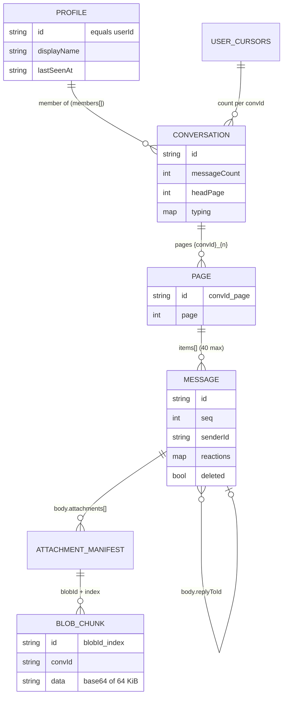

# 06 - Data and "database"

There is **no database we control**. Persistence is the Azure DevOps *Extension Data Service* (the collection's own SQL database underneath, which we cannot see). We use two scopes: **collection** (shared by everyone in the project collection) and **user** (private to one user of that collection). All shapes live in `src/core/model.ts`. All access goes through `src/core/storage.ts` `Store`.

## Platform limits that shape the schema

| Limit | Value | Evidence |
| --- | --- | --- |
| Document id length | 50 chars | enforced by `assertDocId` (`storage.ts:78`); documented by Microsoft |
| "Get all" per collection | 100,000 documents | recorded in the older `docs/03` s3.1 (a stale document; this limit was not re-checked against Microsoft's current documentation; NOT TESTED here) |
| Document size | **undocumented**; differs by server | same older doc. Hence conservative `CHUNK_BYTES` |
| Concurrency | `__etag`; stale write -> HTTP 409; `-1` = last write wins | emulator in `tests/harness/index.cjs` implements the same semantics |
| Cross-extension / cross-collection access | denied / impossible | docs/06 s6.12 (INFERRED) |

## Storage namespace

Every collection name is prefixed with `NAMESPACE` (`model.ts:21`, currently **`"v3"`**), e.g. `v3_pages`. Bumping it gives every client an empty slate; the old documents stay on the server, un-addressed. `v3` was introduced when encryption was removed because the older documents were ciphertext under keys that no longer exist. **Do not bump it for ordinary format changes** - add optional fields instead.

## Collections and documents

| Collection (`COLLECTIONS.*`) | Scope | Document id | Written by | Contents |
| --- | --- | --- | --- | --- |
| `v3_profiles` (`profiles`) | collection | user id (GUID, 36) | the user, for self | `ProfileDoc`: `userId`, `displayName`, `appVersion`, `namespace`, `updatedAt`, `lastSeenAt` |
| `v3_conversations` (`conversations`) | collection | 16 hex chars | any member | `ConversationDoc` (see below) |
| `v3_pages` (`pages`) | collection | `{convId}_{page:5}` = 22 | any member | `PageDoc`: up to 40 `StoredMessage` |
| `v3_blobs` (`blobs`) | collection | `{blobId}_{index:5}` = 18 | uploader | `BlobChunkDoc`: one base64 chunk |
| `v3_readstate` (`readState`) | **user** | `cursors` | the user | `ReadStateDoc`: per-conversation read count |
| settings (`getValue`/`setValue`, user scope) | **user** | key | the user | `pending-subject` (hand-off from menu actions), `ui-language` (`"en"`/`"fa"`) |

### `ConversationDoc` (`model.ts:114`)
`id`, `kind` (`dm | channel | workitem | commit`), `title?`, `members[]` (sorted user ids, plaintext), `createdBy`, `createdAt`, `headPage`, `messageCount` (total slots ever reserved; also the unread watermark), `lastActivityAt`, `lastMessageId?`, `lastSenderId?`, `lastPreview?` (first 120 chars of the newest message, or `📎 name` for an attachment-only message which is not truncated; **plaintext**; written only on send - it is NOT cleared when that message is edited or deleted, `13_` KI-21), `subject?` (`{type, key, repositoryId?, projectId?}`), `typing?` (`{userId: ISO time}`, ephemeral, see TTL below).

### `PageDoc` / `StoredMessage` (`model.ts:159`, `:165`)
`PageDoc`: `convId`, `page`, `items[]`. `StoredMessage`: `id`, `senderId`, `seq?`, `sentAt`, `body` (`MessageBody`), `deleted?`, `reactions?` (`{emoji: [userId...]}`).
`MessageBody`: `text`, `mentions?`, `attachments?` (`AttachmentManifest[]`), `replyToId?`, `editedAt?`.
`AttachmentManifest`: `blobId`, `name`, `size`, `mime`, `chunks`, `chunkBytes`, `sha256`, `width?`, `height?`.

### Id formats (the on-disk contract - never change casually)

| Id | Built by | Format | Length |
| --- | --- | --- | --- |
| DM conversation | `dmId` `conversations.ts:29` | `SHA-256("dm|" + sortedIdsJoinedBy"|")` -> first 16 hex | 16 |
| Subject conversation | `subjectId` `:32` | `SHA-256(type|repositoryId|key)` -> first 16 hex | 16 |
| Channel | `Conversations.createChannel` | `randomId(8)` -> 16 hex | 16 |
| Page | `pageDocId` `messages.ts` | `{convId}_{page:5 zero-padded}` | 22 |
| Message | `newMessageId` | base36 time padded to 9 + `-` + 6 hex | 16 |
| Attachment | `Files.upload` | base36 time (8 chars) + base36 random (1-4 chars), cut to 12 | 9-12 (usually 12) |
| Chunk | `chunkDocId` | `{blobId}_{index:5}` | 15-18 |

## Entity relationships

There are **no foreign-key constraints**; relationships are by id convention and can dangle (e.g. chunks whose message was never written).

## Lifecycles

**Conversation**: created lazily on first open (DM id is deterministic, so both sides converge via `mutate` upsert) -> `messageCount` grows on each send -> members may be added/removed -> deleted by `ChatClient.deleteConversation` (attachments via manifests, then pages, then the conversation doc, then the caller's read cursor). Deleting is for **all members**; any member can do it.

**Message**: id + `seq` reserved on the conversation doc (write 1) -> appended to its page (write 2) -> may be edited (`editedAt` set), reacted to, or deleted (body removed, slot kept as tombstone so ordering and counts stay stable). Attachments of a deleted message have their chunks removed.

**Attachment**: chunk docs written first (4 concurrent), manifest embedded in the message afterwards. If anything fails between - the browser dies, the later message write throws, or one chunk lane fails while the others finish - the chunks are **orphans** (no message references them). The composer keeps the files, so a retry uploads them again under a new blob id and the old chunks stay behind. There is currently no safe cleanup (`13_` KI-01, KI-24).

**Profile**: written by the user at startup (and at most every 5 min for `lastSeenAt`). A display name that *looks like* a SID/GUID is never written.

**Typing flag**: a map on the conversation doc; entries older than `TYPING_TTL_MS` (8 s) are ignored by readers and pruned by the next writer; writes throttled to one per 3.5 s per conversation; skipped when the conversation has more than 12 members.

**Read cursor**: per user, per conversation; written only when it advances.

## Capacity (from docs/08 s8.2, re-derived; NOT TESTED on a real server)

- A 16 MiB file = 256 chunk docs (~88 KB JSON each after base64). About 390 such files would reach the 100,000-doc "get all" cap for `v3_blobs`.
- 4,000,000 messages = 100,000 page docs; unlikely to matter before attachments do.
- Sidebar poll reads **every conversation doc in the collection** every 30 s per open tab; cost scales with total conversations of all users, not just yours.

## Migrations

There is **no migration framework**. Strategy: (1) additive optional fields (done for `seq`, `lastPreview`, `reactions`, `typing`, `lastSeenAt`, image `width/height`) - older builds ignore them; (2) code must tolerate missing optional fields (e.g. `present` falls back to `sentAt` ordering when `seq` is absent); (3) as a last resort bump `NAMESPACE`. See `12_TASK_PLAYBOOKS.md` "Add a field to stored data".

## Backup and restore

Chat data lives in the collection database, so the normal Azure DevOps collection backup covers it (docs/08 s8.4; NOT TESTED). Consequences: restoring the collection **rolls chat back**; backups contain **plaintext** messages; there is no separate export tool. To wipe everything the extension stored, bump `NAMESPACE` (non-destructive) or delete documents through the Extension Management REST API (not implemented here).

## Inspecting data

- In the browser console of the hub frame: `await secureChatDiagnose()` prints version, namespace, profiles, directory status and per-conversation counts. **No message text.**
- In tests/emulator: `harness.state.documents` is a `Map` of scope -> collection -> id -> doc.
